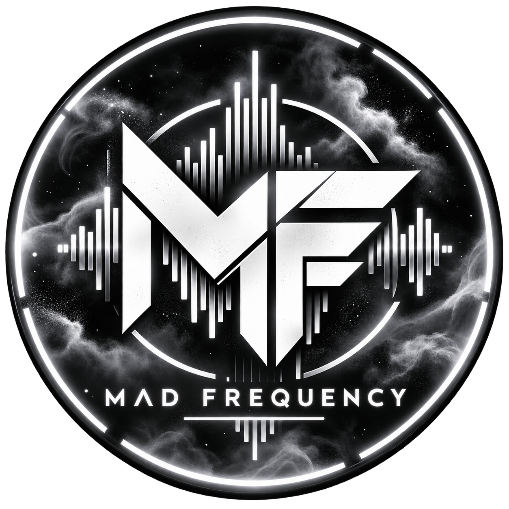

 

  

<h1 align="center">MAD FREQUENCY Creator License</h1>

  <strong>Free music for content creators.</strong>

MAD FREQUENCY creates original music across multiple genres. We allow creators worldwide to use eligible MAD FREQUENCY tracks in their videos, streams and other online content for free, subject to our Creator License.

## What You Can Do

- Use our music in YouTube videos, Shorts, Twitch streams, TikTok videos and Instagram Reels.
- Monetize your content.
- Use our music in gaming videos, edits, livestreams and personal projects.
- Share your creativity with MAD FREQUENCY music, free of charge.

## What We Require

- Credit MAD FREQUENCY and the track title.
- Include a link to the original track whenever possible.
- Do not claim ownership or authorship of our music.
- Do not redistribute or sell our music as a standalone product.
- Follow all the terms of the full Creator License.

## Paid Advertising

**Paid advertising requires prior written permission.**

If you want to use MAD FREQUENCY music in paid advertisements, brand campaigns or promotional content created to advertise a product or service, you must request authorization before using the music.

Ordinary monetization of your own videos and streams is permitted under this license. This includes revenue earned through platform monetization, such as YouTube ads displayed around your content.

## Read the Full License

Please read the complete terms before using our music.

**[Read the MAD FREQUENCY Creator License](LICENSE.md)**

## Follow MAD FREQUENCY

- **YouTube:** [MAD FREQUENCY](https://www.youtube.com/@MADFREQUENCY_MF)
- **TikTok:** [@madfrequency.mf](https://www.tiktok.com/@madfrequency.mf)
- **Instagram:** [@madfrequency.mf](https://www.instagram.com/madfrequency.mf/)
- **SoundCloud:** [MAD FREQUENCY](https://soundcloud.com/mad-frequency-280523923)

## Contact and Permission Requests

For paid advertising requests or licensing questions, contact MAD FREQUENCY through our official social media channels.

Please include the track title, intended use, platform and campaign details when requesting permission.

---

  <strong>MAD FREQUENCY</strong> 
  Original music. Multiple genres. One frequency.

© 2026 MAD FREQUENCY. All rights reserved, subject to the Creator License.
